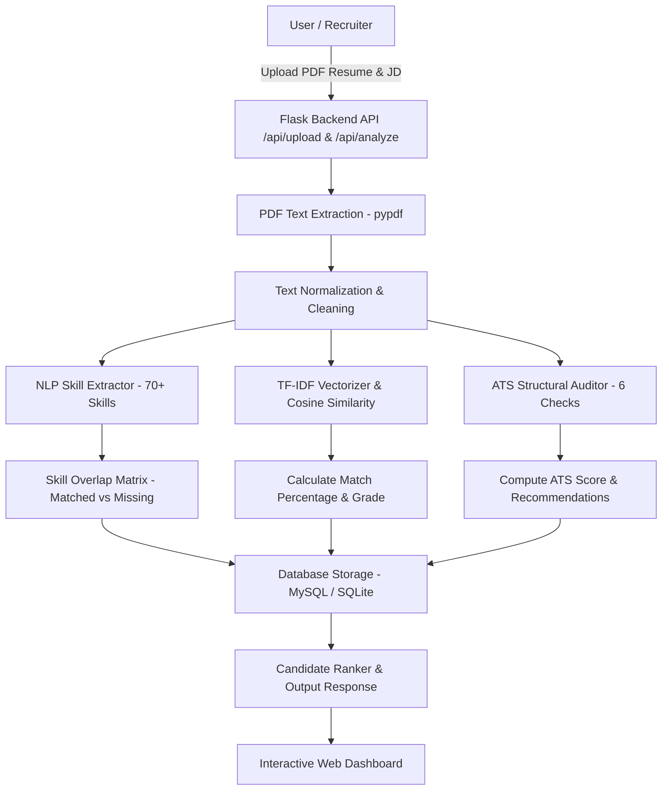
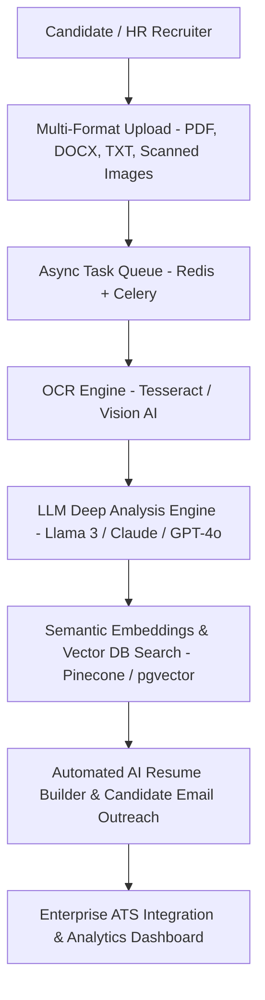

# 📄 AI Resume Screener & ATS Candidate Ranker

An intelligent, full-stack AI Resume Screener and Applicant Tracking System (ATS) optimization tool. Built with Python (Flask), Scikit-Learn (TF-IDF & Cosine Similarity), `pypdf`, and a dual-database architecture (MySQL + SQLite fallback).

---

## 🌟 Overview & Key Features (Work Completed)

- **PDF Resume Extraction & Cleaning**: Automatic text extraction from PDF documents using `pypdf` with regex normalization and noise reduction.
- **NLP & TF-IDF Cosine Similarity Engine**: Computes exact candidate match percentage against job descriptions using TF-IDF n-gram vectorization and cosine distance matrix calculation.
- **Skill Gap & Keyword Analysis**:
  - Extracts over 70+ technical skills across Languages, Frameworks, Cloud, Databases, and AI/ML.
  - Automatically identifies **Matched Skills** vs. **Missing Skills**.
  - Highlights top job description keywords and verifies their presence in the candidate's resume.
- **ATS Structural Readiness Auditor**: Evaluates resume readability across 6 critical ATS criteria (email, phone, work history, education, skills section, and document length) with a 0–100 ATS Score.
- **Dual Screening Modes**:
  - **Candidate Mode**: Single resume optimization against a target job posting.
  - **HR / Recruiter Mode**: Multi-resume batch upload (up to 10 resumes) with automated candidate ranking from highest to lowest ATS/match score.
- **Dual Database Engine (MySQL + SQLite Fallback)**: Automatically connects to MySQL database if available; seamlessly falls back to a zero-config SQLite database (`resume_screener.db`).
- **Secure Authentication & Google OAuth 2.0**:
  - Native authentication with Werkzeug password hashing.
  - Integrated **Google OAuth 2.0 Sign In / Sign Up** with CSRF state token validation.
- **Automated Contact Us & Customer Support System**:
  - Unique Ticket ID generator (`HH-TK-XXXXXXXX`) and dual-database ticket storage.
  - Email notification engine supporting **Resend API** and **SMTP** with graceful offline/demo fallback.
  - Automated customer acknowledgment emails with ticket tracking reference.
  - Honeypot spam trap and sliding-window IP/email rate limiting.
  - Glassmorphic ticket confirmation UI with one-click reference code copying.
- **Screening History Dashboard**: Track, view, delete, or clear past resume analysis reports.
- **Premium Glassmorphic UI**: Responsive dark theme UI with HSL gradients, CSS glassmorphism, animated SVG score gauges, modal candidate inspectors, and dynamic tab management.

---

## 🔄 Current Workflow Architecture



### Current Processing Flow:
1. **Upload**: User submits PDF resume(s) and job description via the interactive UI.
2. **Processing**: `pypdf` parses raw text; custom NLP functions clean the text and extract technical skills.
3. **Matching**: Scikit-Learn TF-IDF vectorizer extracts n-grams and computes Cosine Similarity match percentage.
4. **ATS Audit**: Evaluates contact info, section headings, and word count.
5. **Persistence**: Saves analysis records to MySQL or SQLite.
6. **Visualization**: Displays dynamic score gauges, skill badges, ATS checklists, and ranked recruiter leaderboards.

---

## 🔮 Future Workflow & Roadmap



### Planned Future Features:
1. **AI Deep LLM Insights & Feedback**: Integration with LLMs (Llama 3 / GPT-4o / Claude) to generate personalized resume rewriting advice, bullet-point improvements, and candidate interview question generation.
2. **Multi-Format & OCR Support**: Expand file parsing beyond PDF to support `.docx`, `.txt`, and image/scanned PDF processing via Tesseract OCR.
3. **Asynchronous Batch Processing**: Redis + Celery task queue integration for scaling batch screening to hundreds of resumes concurrently.
4. **Vector Database Semantic Search**: Implement vector embeddings (Dense Retrieval) alongside TF-IDF for contextual understanding (e.g. matching "React developer" with "Frontend Engineer").
5. **Role-Based Access Control (RBAC)**: Enterprise organization accounts, team sharing, and candidate submission portals.
6. **Automated Candidate Outreach & Emailing**: Direct one-click email scheduling and CSV/PDF export of screening reports.

---

## 🚀 Getting Started

### 1. Prerequisites
- Python 3.9+
- Pip package manager

### 2. Installation & Setup

```bash
# Clone the repository
git clone <YOUR_REPOSITORY_URL>
cd "RESUME SCREENER"

# Create a virtual environment
python -m venv .venv

# Activate virtual environment
# On Windows:
.venv\Scripts\activate
# On macOS/Linux:
source .venv/bin/activate

# Install dependencies
pip install flask scikit-learn pypdf mysql-connector-python requests werkzeug
```

### 3. Environment Variables (Optional for Google OAuth & Custom Port)
Create a `.env` file or export environment variables:
```bash
export SECRET_KEY="your-custom-secret-key"
export GOOGLE_CLIENT_ID="your-google-client-id"
export GOOGLE_CLIENT_SECRET="your-google-client-secret"
```

### 4. Running the Application

```bash
python app.py
```
Open your browser and navigate to `http://127.0.0.1:5000`.

---

## 🛠️ Tech Stack

- **Backend**: Python 3, Flask, Scikit-Learn, PyPDF, Requests, Werkzeug
- **Database**: Dual Engine — MySQL (`mysql-connector-python`) with automatic SQLite fallback (`sqlite3`)
- **Frontend**: HTML5, CSS3 (Vanilla Glassmorphism & Custom Properties), Modern ES6 JavaScript
- **Auth**: Native Password Hashing & Session Management + Google OAuth 2.0 Integration
- **Version Control**: Git

---

## 📄 License
This project is open-source under the MIT License.
